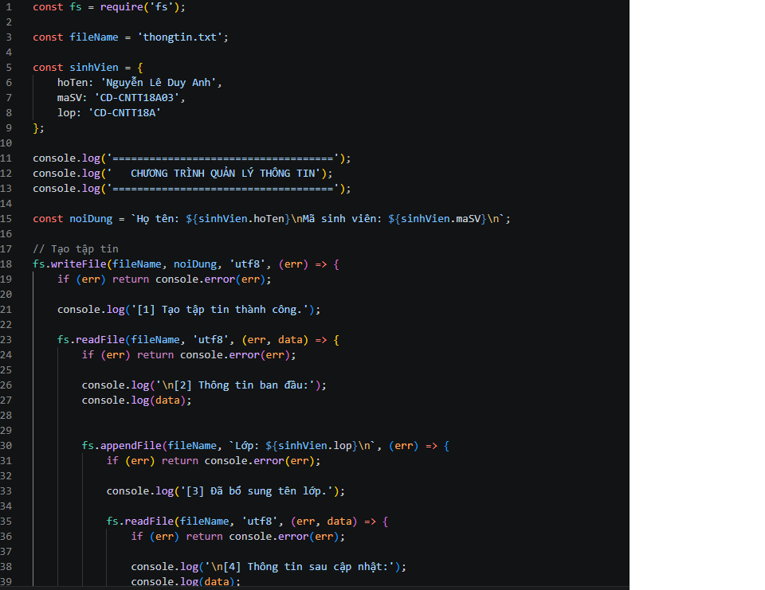
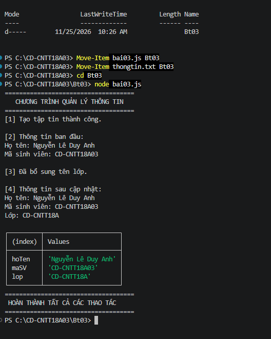
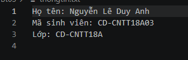

# BÀI TẬP 3 – MODULE FILE SYSTEM (FS)

## 1. Thông tin sinh viên

- Họ và tên: Nguyễn Lê Duy Anh
- Mã sinh viên: CD-CNTT18A03
- Lớp: CD-CNTT18A
- Môn học: NodeJS
- Bài thực hành: Bai03 – Bt03

## 2. Mục tiêu bài tập

Sử dụng module fs trong Node.js để tạo, đọc và cập nhật nội dung tập tin.

## 3. Các chức năng thực hiện

- Tạo tập tin thongtin.txt chứa họ tên và mã sinh viên.
- Đọc và hiển thị nội dung ban đầu.
- Ghi nối thêm tên lớp bằng appendFile().
- Đọc lại nội dung sau khi cập nhật.
- Hiển thị bảng thông tin sinh viên trên Terminal.

## 4. Các phương thức sử dụng

| Phương thức | Chức năng |
|---|---|
| require('fs') | Khai báo module fs |
| fs.writeFile() | Tạo và ghi nội dung tập tin |
| fs.readFile() | Đọc nội dung tập tin |
| fs.appendFile() | Ghi nối thêm nội dung |
| console.log() | Hiển thị thông báo |
| console.table() | Hiển thị bảng thông tin |

## 5. Hướng dẫn chạy chương trình

Mở Terminal trong thư mục Bt03 và thực hiện lệnh:

`node bai03.js`

## 6. Hình ảnh minh chứng

### 6.1. Mã nguồn chương trình

### 6.2. Kết quả chạy trên Terminal

### 6.3. Nội dung tập tin sau cập nhật

## 7. Kết quả dự kiến

Tập tin thongtin.txt chứa đầy đủ thông tin:

- Họ tên: Nguyễn Lê Duy Anh
- Mã sinh viên: CD-CNTT18A03
- Lớp: CD-CNTT18A

## 8. Kết luận

Chương trình thực hiện các thao tác tạo, đọc và cập nhật tập tin bằng module fs trong Node.js, đáp ứng yêu cầu bài thực hành.
