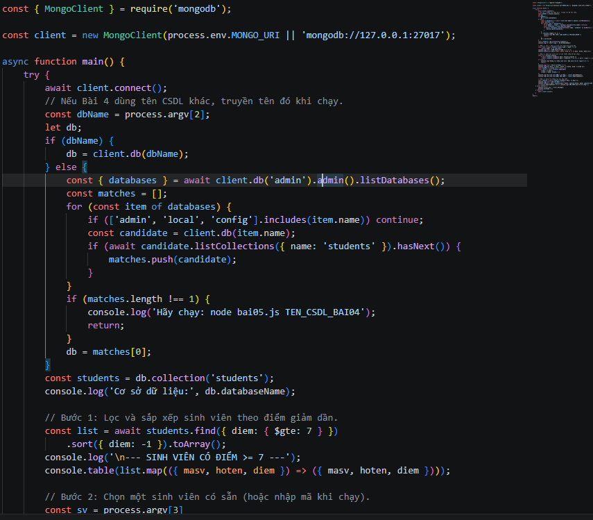
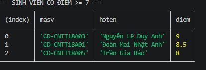
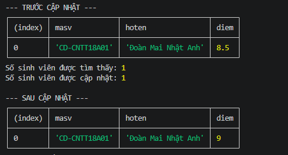

# BÀI 5. TRUY VẤN VÀ CẬP NHẬT DỮ LIỆU MONGODB

## 1. Thông tin sinh viên

- Mã sinh viên: CD-CNTT18A03
- Lớp: CD-CNTT18A
- Môn học: Lập trình NodeJS
- Bài học: Bài 3 – Module, File System và cơ sở dữ liệu
- Bài thực hành: Bt05

## 2. Mục tiêu bài thực hành

- Biết cách kết nối NodeJS với MongoDB.
- Sử dụng collection students đã tạo ở Bài 4.
- Biết cách truy vấn dữ liệu bằng find().
- Sử dụng toán tử $gte để lọc dữ liệu.
- Sắp xếp dữ liệu bằng sort().
- Cập nhật dữ liệu bằng updateOne() và $set.
- Kiểm tra thông tin sinh viên sau khi cập nhật.

## 3. Yêu cầu bài thực hành

Tạo tập tin bai05.js thực hiện các chức năng:

- Tìm các sinh viên có diem >= 7.
- Sắp xếp kết quả theo điểm giảm dần.
- Cập nhật điểm của một sinh viên theo masv.
- Hiển thị lại thông tin sau cập nhật.
- Thông báo kết quả thực hiện trên Terminal.

## 4. Công nghệ sử dụng

- NodeJS.
- JavaScript.
- MongoDB.
- Visual Studio Code.
- Git và GitHub.

## 5. Cấu trúc thư mục

    NodeJS/
    └── Bai03/
        └── Bt05/
            ├── bai05.js
            ├── Readme.md
            └── images/
                ├── 01_Code.png
                ├── 02_LocSapXep.png
                └── 03_KetQua.png

## 6. Hướng dẫn thực hiện

### 6.1. Cài đặt thư viện MongoDB

Mở Terminal trong Visual Studio Code và thực hiện:

```bash
npm install mongodb
```

Nếu sử dụng PowerShell và gặp lỗi npm.ps1:

```bash
npm.cmd install mongodb
```

### 6.2. Kết nối MongoDB

```javascript
const { MongoClient } = require('mongodb');

const client = new MongoClient(
    process.env.MONGO_URI || 'mongodb://127.0.0.1:27017'
);
```

Sử dụng MongoClient để kết nối NodeJS với MongoDB.

### 6.3. Sử dụng collection students

```javascript
const students = db.collection('students');
```

Sử dụng dữ liệu sinh viên đã được tạo trong Bài 4,
không tạo lại hoặc xóa dữ liệu cũ.

### 6.4. Tìm sinh viên có điểm từ 7 trở lên

```javascript
students.find({ diem: { $gte: 7 } })
```

Trong đó:

- find(): truy vấn dữ liệu.
- diem: trường lưu điểm sinh viên.
- $gte: toán tử lớn hơn hoặc bằng.
- 7: giá trị điểm dùng để lọc.

### 6.5. Sắp xếp điểm giảm dần

```javascript
const list = await students
    .find({ diem: { $gte: 7 } })
    .sort({ diem: -1 })
    .toArray();
```

Trong đó:

- sort(): sắp xếp kết quả truy vấn.
- -1: sắp xếp theo thứ tự giảm dần.
- toArray(): chuyển kết quả thành mảng.

### 6.6. Cập nhật điểm sinh viên

```javascript
const diemMoi = sv.diem === 9 ? 8.5 : 9;

const result = await students.updateOne(
    { masv: sv.masv },
    { $set: { diem: diemMoi } }
);
```

Trong đó:

- updateOne(): cập nhật một sinh viên.
- masv: mã sinh viên cần cập nhật.
- $set: thay đổi giá trị của trường diem.
- diemMoi: giá trị điểm mới.

Chương trình cập nhật điểm thành 9.
Nếu điểm cũ đã bằng 9 thì cập nhật thành 8.5.

### 6.7. Kiểm tra thông tin sau cập nhật

```javascript
const updated = await students.findOne({
    masv: sv.masv
});

console.table([{
    masv: updated.masv,
    hoten: updated.hoten,
    diem: updated.diem
}]);
```

Sử dụng findOne() để kiểm tra thông tin sinh viên
sau khi cập nhật điểm.

## 7. Hướng dẫn chạy chương trình

Đảm bảo MongoDB đang hoạt động và đã có collection
students của Bài 4.

Mở Terminal tại thư mục Bt05 và nhập:

```bash
node bai05.js
```

Nếu có nhiều cơ sở dữ liệu chứa collection students,
chỉ định tên cơ sở dữ liệu của Bài 4:

```bash
node bai05.js TEN_CSDL_BAI04
```

## 8. Hình ảnh thực hành

### 8.1. Mã nguồn chương trình bai05.js



### 8.2. Kết quả lọc và sắp xếp sinh viên



Danh sách sinh viên có điểm lớn hơn hoặc bằng 7
được sắp xếp theo thứ tự điểm giảm dần.

### 8.3. Kết quả cập nhật điểm sinh viên



Chương trình hiển thị thông tin trước và sau cập nhật
để kiểm tra sự thay đổi của dữ liệu.

## 9. Kết quả cần đạt

- Kết nối thành công với MongoDB.
- Truy vấn đúng các sinh viên có điểm từ 7 trở lên.
- Sắp xếp điểm theo thứ tự giảm dần.
- Cập nhật điểm đúng theo mã sinh viên.
- Hiển thị thông tin trước và sau khi cập nhật.
- Thông báo cập nhật thành công.
- Không làm mất dữ liệu sinh viên của Bài 4.

## 10. Tổng kết các lệnh MongoDB

| Lệnh | Chức năng |
|---|---|
| find() | Truy vấn danh sách dữ liệu |
| $gte | Lọc giá trị lớn hơn hoặc bằng |
| sort() | Sắp xếp dữ liệu |
| toArray() | Chuyển kết quả thành mảng |
| updateOne() | Cập nhật một bản ghi |
| $set | Thay đổi giá trị của một trường |
| findOne() | Tìm một bản ghi |
| console.table() | Hiển thị dữ liệu dạng bảng |

## 11. Link GitHub

https://github.com/dianh2456/NodeJS/tree/master/Bai03/Bt05

## 12. Kết luận

Qua bài thực hành, sinh viên hiểu được cách kết nối
NodeJS với MongoDB, thực hiện truy vấn, lọc, sắp xếp
và cập nhật dữ liệu trong collection students.

Bài thực hành giúp củng cố kiến thức về find(),
$gte, sort(), updateOne(), $set và findOne(),
làm nền tảng để xây dựng các ứng dụng quản lý dữ liệu
bằng NodeJS và MongoDB.
