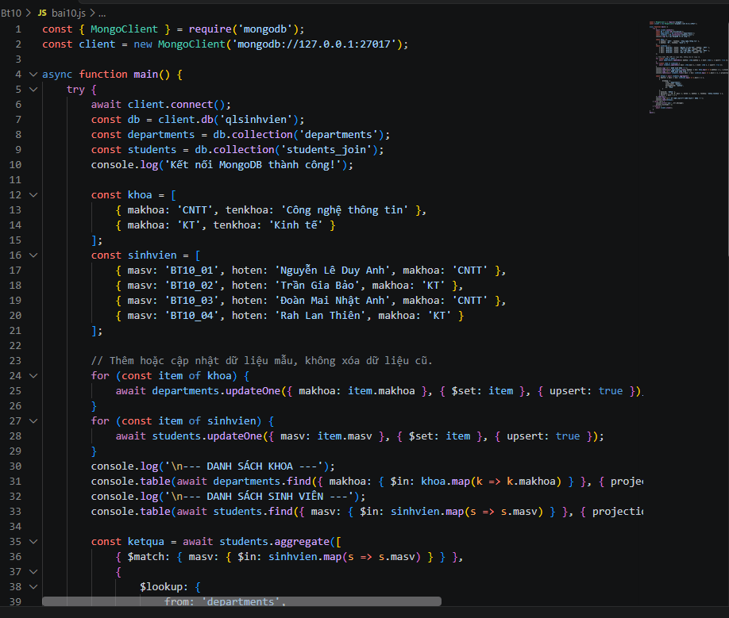
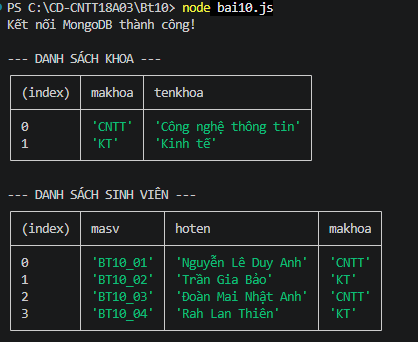
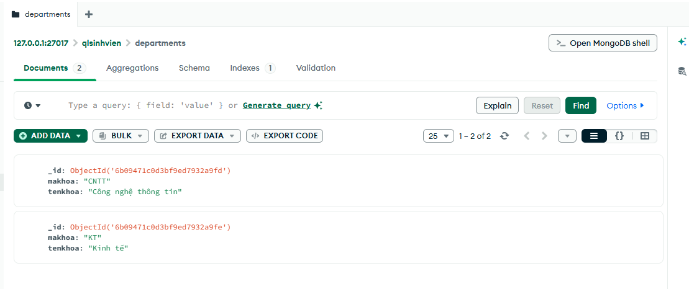
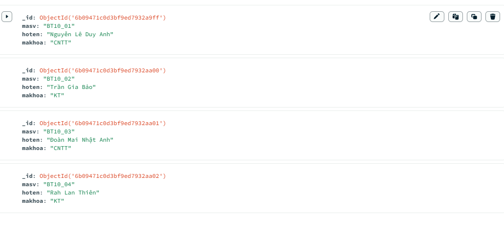
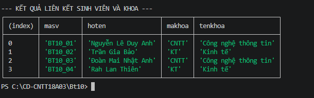

# BÀI TẬP 10 – LIÊN KẾT COLLECTION TRONG MONGODB

## 1. Thông tin sinh viên

- Họ và tên: Nguyễn Lê Duy Anh
- Mã sinh viên: CD-CNTT18A03
- Lớp: CD-CNTT18A
- Môn học: NodeJS

## 2. Mục tiêu bài tập

- Kết nối Node.js với cơ sở dữ liệu MongoDB.
- Tạo dữ liệu khoa và sinh viên.
- Sử dụng aggregate() kết hợp $lookup để liên kết hai collection.
- Hiển thị danh sách sinh viên kèm mã khoa và tên khoa tương ứng.

## 3. Nội dung thực hiện

- Sử dụng cơ sở dữ liệu qlsinhvien.
- Tạo collection departments gồm 2 khoa.
- Tạo collection students_join gồm 4 sinh viên.
- Mỗi khoa có makhoa và tenkhoa.
- Mỗi sinh viên có masv, hoten và makhoa.
- Sử dụng updateOne() và upsert để thêm hoặc cập nhật dữ liệu.
- Sử dụng aggregate() kết hợp $lookup để liên kết dữ liệu thông qua makhoa.
- Sử dụng $unwind để tách dữ liệu khoa.
- Sử dụng $project để lựa chọn các trường cần hiển thị.
- Sử dụng $sort để sắp xếp theo mã sinh viên.
- Hiển thị kết quả bằng console.table().

## 4. Cấu trúc thư mục

```text
Bt10/
├── bai10.js
├── Readme.md
└── images/
    ├── 01_MaNguon.png
    ├── 02_Terminal.png
    ├── 03_Departments.png
    ├── 04_StudentsJoin.png
    └── 05_KetQua.png
```

## 5. Các lệnh thực hiện

### 5.1. Cài đặt thư viện MongoDB

```bash
npm.cmd install mongodb
```

### 5.2. Địa chỉ kết nối MongoDB

```text
mongodb://127.0.0.1:27017
```

### 5.3. Chạy chương trình

```bash
node bai10.js
```

## 6. Hình ảnh thực hiện

### 6.1. Mã nguồn chương trình



### 6.2. Chạy chương trình trên Terminal



### 6.3. Collection departments



### 6.4. Collection students_join



### 6.5. Kết quả liên kết sinh viên và khoa



## 7. Kết quả dự kiến

| Mã sinh viên | Họ tên | Mã khoa | Tên khoa |
|---|---|---|---|
| BT10_01 | Nguyễn Lê Duy Anh | CNTT | Công nghệ thông tin |
| BT10_02 | Trần Gia Bảo | KT | Kinh tế |
| BT10_03 | Đoàn Mai Nhật Anh | CNTT | Công nghệ thông tin |
| BT10_04 | Rah Lan Thiên | KT | Kinh tế |

## 8. Kết luận

Bài tập thực hiện liên kết hai collection departments
và students_join trong MongoDB bằng aggregate()
kết hợp $lookup.

Kết quả cần hiển thị đầy đủ mã sinh viên, họ tên,
mã khoa và tên khoa tương ứng, đáp ứng yêu cầu
của bài thực hành.